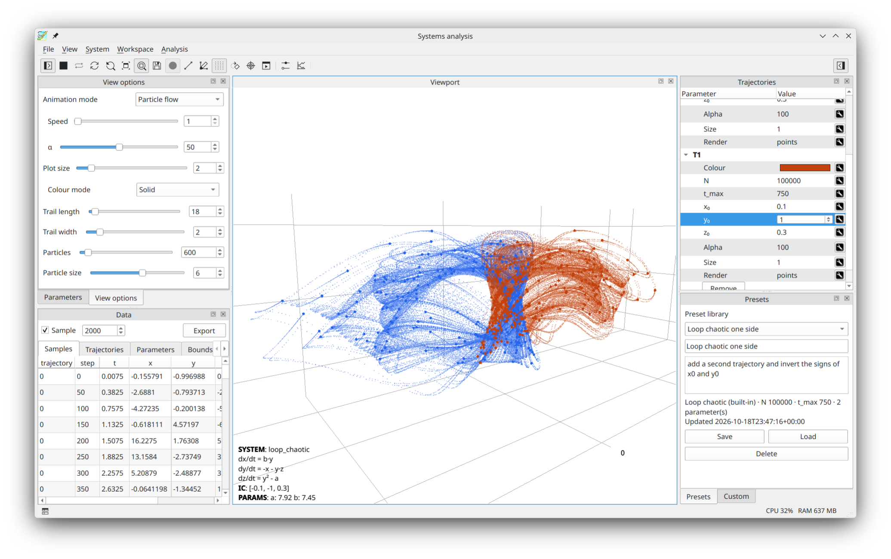
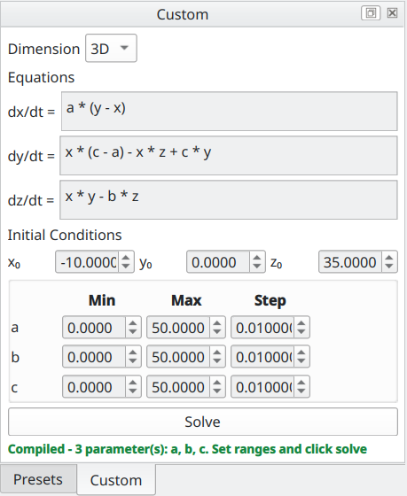
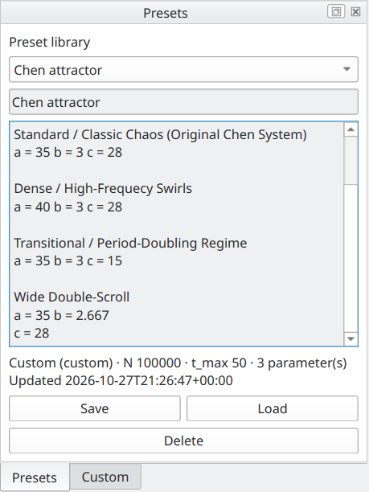
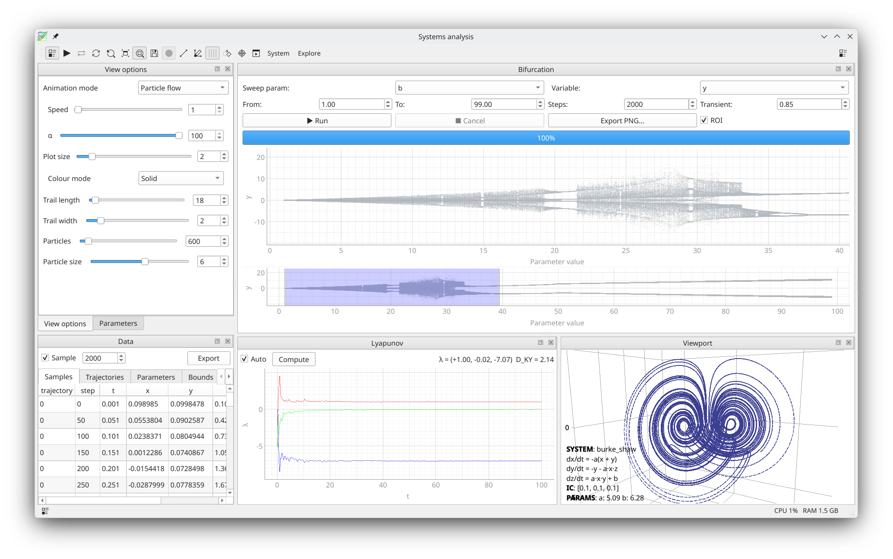
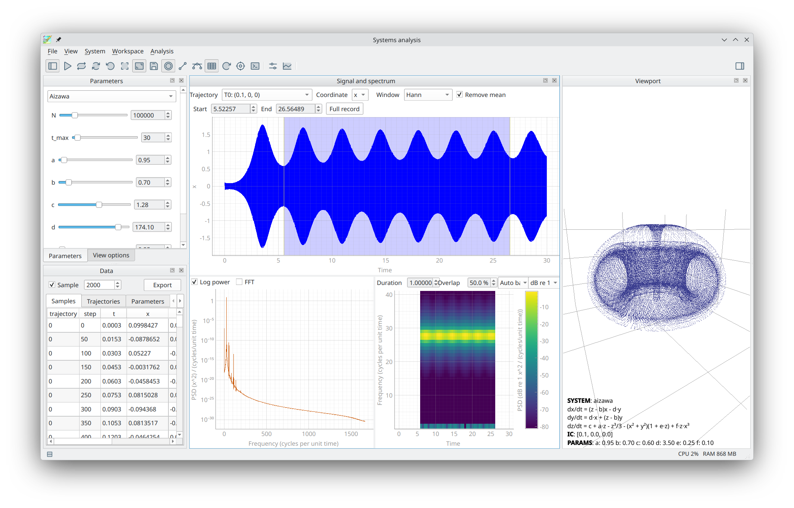
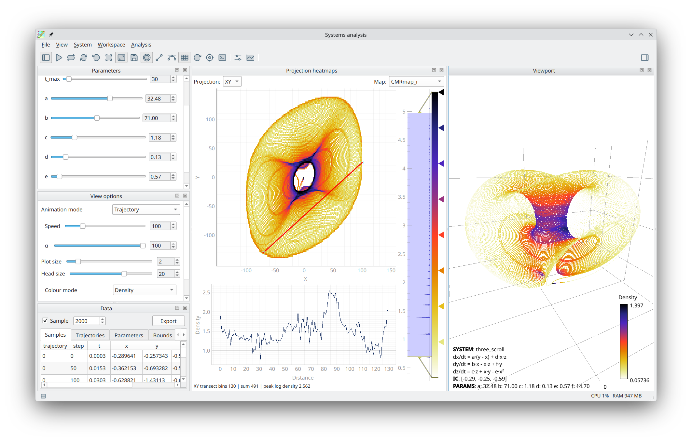
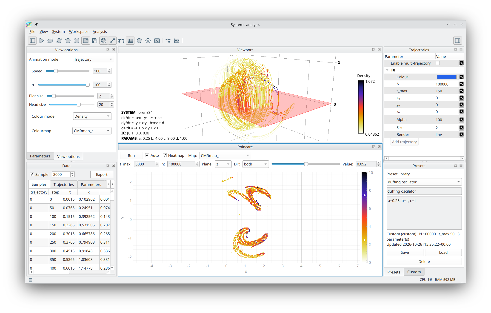
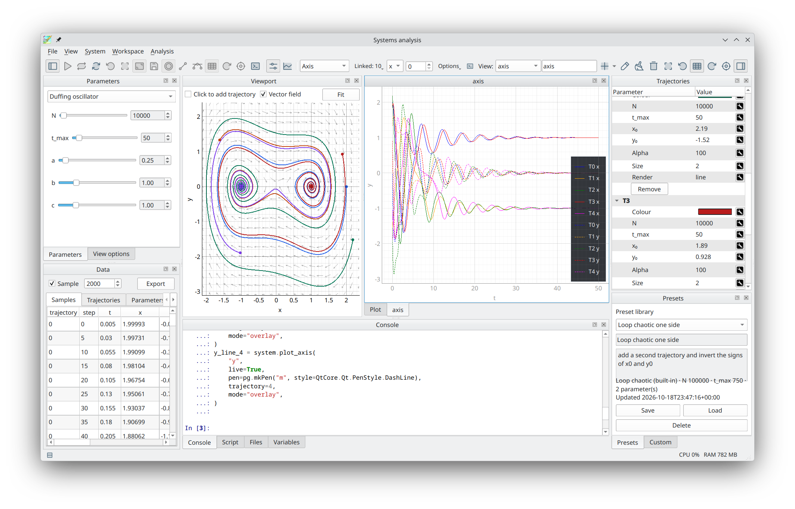
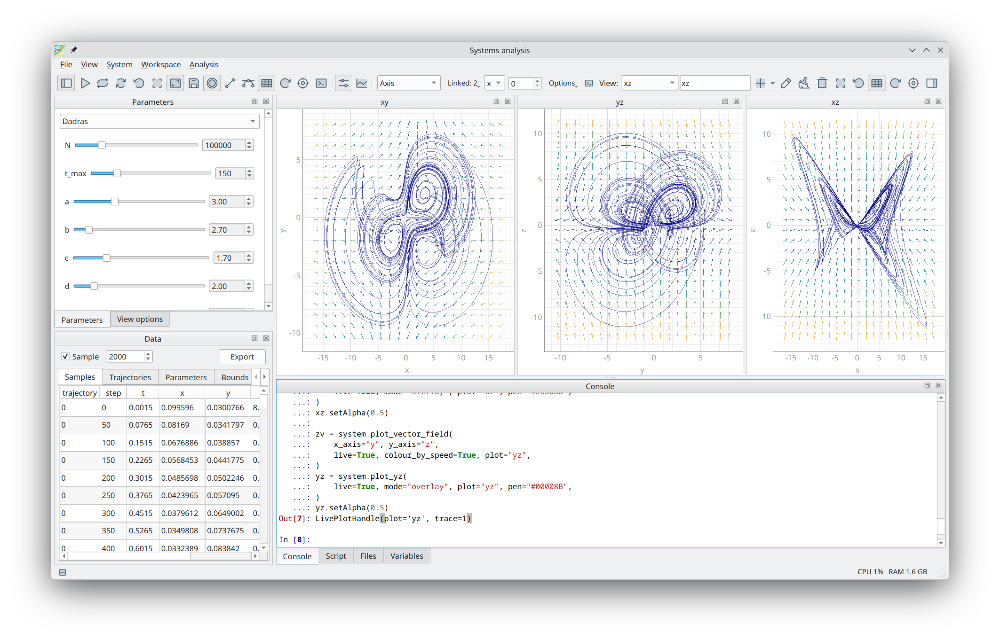
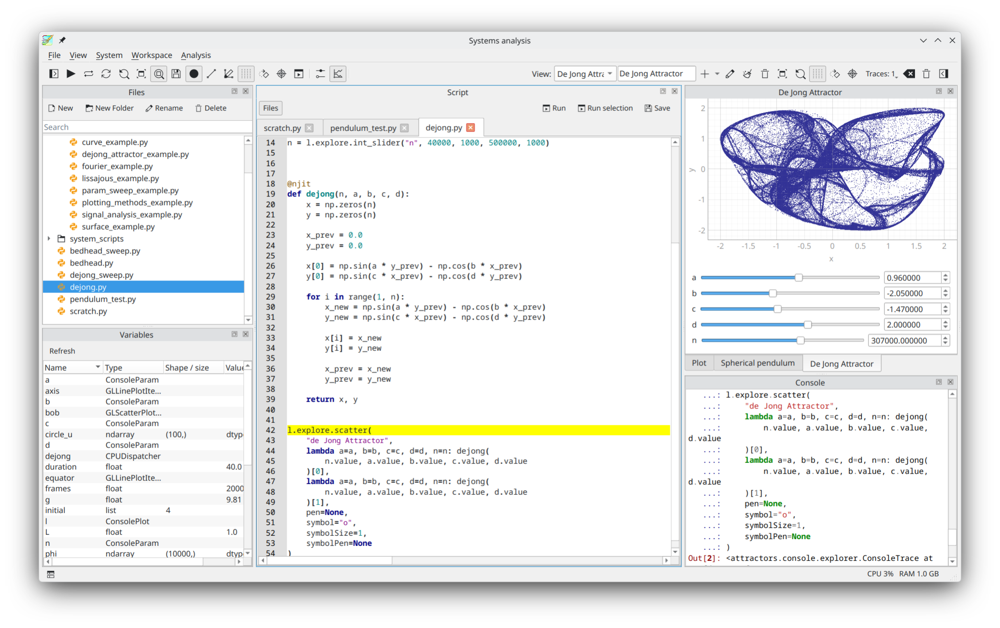

# strange-attractors-qt

Python tool for mathematical visualisation and exploration.

## Installation

Requires Python >=3.12 and
[uv](https://docs.astral.sh/uv/getting-started/installation/).

```bash
git clone https://github.com/aymenhafeez/strange-attractors-qt
cd strange-attractors-qt
uv tool install .
analysis
```

`analysis --help` will show the available flags.

```
usage: analysis [-h] [--reset] [--explore] [--system] [--default] [--fullscreen]
                [--attractor {Lorenz,Three-scroll,Double-scroll,Lorenz84,Aizawa,Loop chaotic,Burke-Shaw,Dadras,Four wing}] [--preset PRESET]
                [--mode {Lyapunov,Projection,Poincare,Bifurcation}] [--theme {system,light,dark}]

options:
  -h, --help            show this help message and exit
  --reset               Run with fresh session state
  --explore             Run explore workspace
  --system              Run system workspace
  --default             Run with the default layout without resetting session state
  --fullscreen          Run in fullscreen
  --attractor {Lorenz,Three-scroll,Double-scroll,Lorenz84,Aizawa,Loop chaotic,Burke-Shaw,Dadras,Four wing}
                        Load with a builtin attractor
  --preset PRESET       Load a saved preset system
  --mode {Lyapunov,Projection,Poincare,Bifurcation}
                        Run analysis mode
  --theme {system,light,dark}
                        Set the theme for plot/view widgets
```

## Features and usage

The app launches in the viewport area by default, a central view of the system with
controls in surrounding panels. Every panel is contained within a dock and so the layout
of the panels can be moved around to suit any given workflow. Panels can be toggled from
the _View_ $\rightarrow$ _Panels_ menu.



While the app comes with a selection of systems builtin, it also allows you to input any
2D or 3D ODE system in the _Custom_ panel. Custom or builtin system configurations can
be saved with notes in the _Presets_ panel.

<p align="center">


</p>

The selected system can be controlled from the parameter control panel, with the view
and animation options located in the _View options_ panel. Data for the current system
can be exported from the _Data view_ panel. The _Trajectory_ panel allows for comparison
of the current system at varying initial conditions. The selected system can then be
explored through the available analysis modes:

<table>
  <tr>
    <td width="50%" align="center">
      
      <small>Bifurcation diagram and Lyapunov convergence plot</small>
    </td>
    <td width="50%" align="center">
      
      <small>Signal and spectrum analysis</small>
    </td>
  </tr>
  <tr>
    <td width="50%" align="center">
      
      <small>Projection heatmap</small>
    </td>
    <td width="50%" align="center">
      
      <small>Poincaré section map</small>
    </td>
  </tr>
</table>

### System workspace

The system workspace allows you to explore the selected system through the text editor
and console. It can be toggled from the toolbar or from the _Analysis_ $\rightarrow$
_System_ menu option. All commands here are prefixed with `system.`, so tabbing in the
console will show all the available commands. `system.help()` will also show the
available commands, and can optionally be viewed in the table viewer by passing
`table=True`.

<table>
  <tr>
    <td width="50%" align="center">
      
      <br />
      <small>Time series plots across various initial conditions</small>
    </td>
    <td width="50%" align="center">
      
      <br />
      <small>2D projections overlain on vector field quiver plots</small>
    </td>
  </tr>
</table>

### Explore workspace

The explore workspace is a general scripting area. It can be accessed from the
_Workspace_ $\rightarrow$ _Mode_ $\rightarrow$ _Explore_ menu option. Here, you can
create 2D and 3D interactive plots and animations with standard Python and the app's
plotting API. The app comes bundled with an 'examples' directory in file browser,
including the above interactive plot of the Peter de Jong attractor. You can also run
`explore.help()`, also optionally with `table=True`, to see all the available commands.



You can return to the viewport area from _Workspace_ $\rightarrow$ _Mode_ $\rightarrow$
_System_.

If you run into any issues check the output panel (toggled from the bottom left or the
_View_ menu option) and file a bug report.

## Development

Feel free to submit PR's and feature requests. To work on the project:

```bash
git clone https://github.com/aymenhafeez/strange-attractors-qt
cd strange-attractors-qt
uv sync
uv run analysis
```

Testing and linting:

```bash
uv add --dev ruff pytest

uv run ruff check .
uv run pytest
```

Enable performance logging:

```bash
ANALYSIS_PROFILE=1 uv run analysis
```

---

Copyright (c) 2026 Aymen Hafeez

This project is licensed under the GNU General Public License, version 3. See LICENSE
for details.
